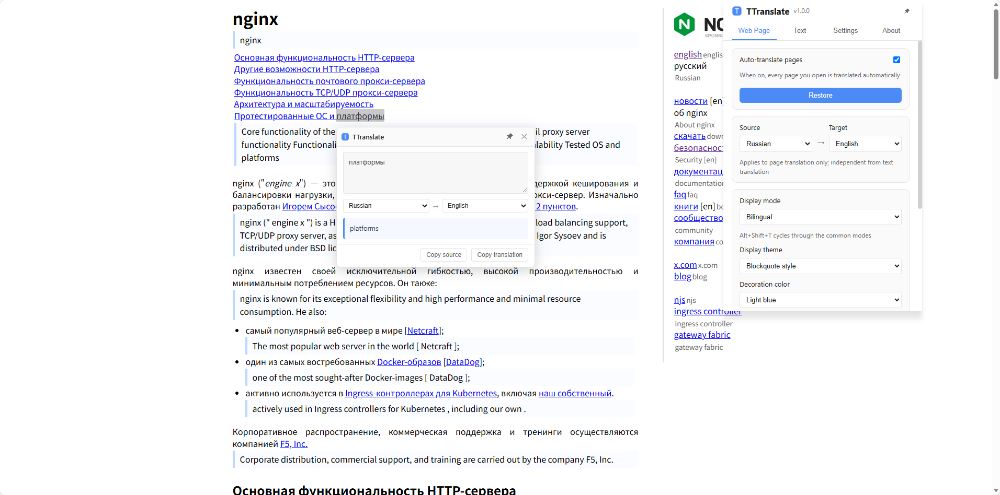
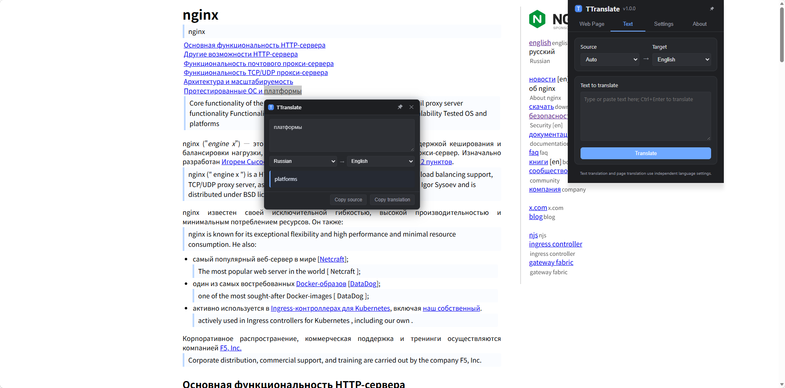
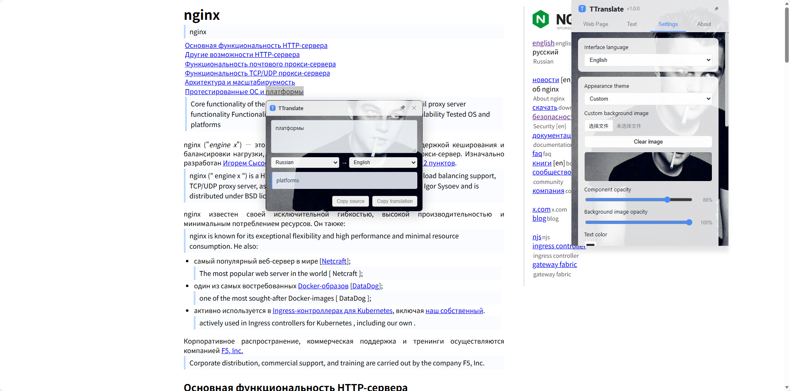

# TTranslate

English | [简体中文](README.md)

> A browser extension for side-by-side translation.

## Screenshots

**Full-page bilingual translation + selection translation**

**Text translation: instant translate for input boxes and paragraphs**

**UI themes: custom background image, component and background opacity**

## Core Features

| Feature | Coverage | Description |
|---|---|---|
| Side-by-side translation | ✅ Full | target-wrapper + block/inline rendering + position before/after + theme CSS variables |
| Input translation | ✅ | Type `/` in a focused input/textarea to translate its content in place |
| Selection translation | ✅ | Select text, then click the extension icon to translate it |

## Installation (Chrome / Edge)

1. Open the extensions page: `chrome://extensions/`
2. Enable "Developer mode" in the top-right corner
3. Click "Load unpacked" and select the `TTranslate` directory
4. Pin TTranslate to the toolbar and click the icon to open the popup
5. Alternatively, drag and drop the `.crx` file onto the extensions page

## Keyboard Shortcuts

| Action | Shortcut |
|---|---|
| Toggle translation of the current page | `Alt+T` |
| Input translation | Type `/` in a focused input/textarea |

## License

This project is open source under the MIT license, for learning and communication purposes only.
