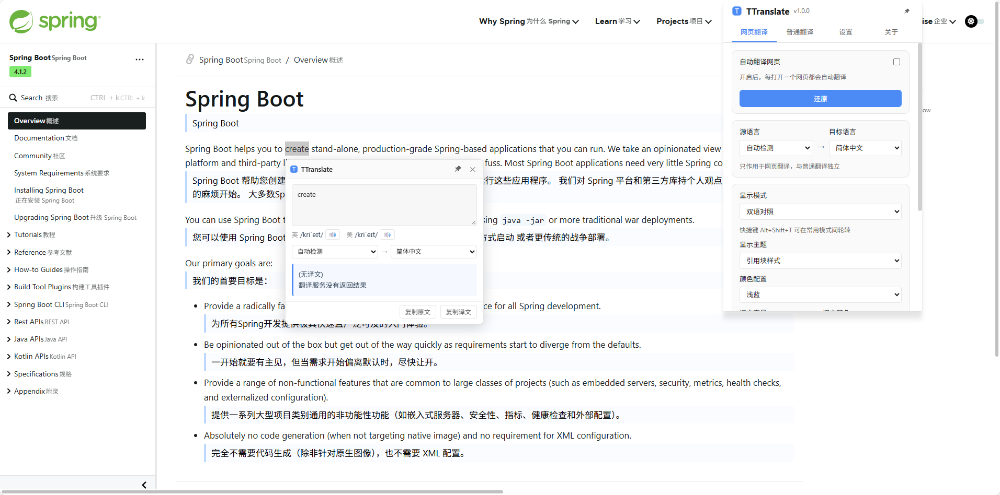
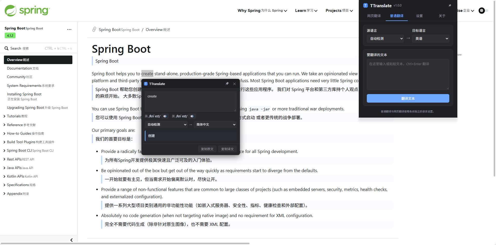
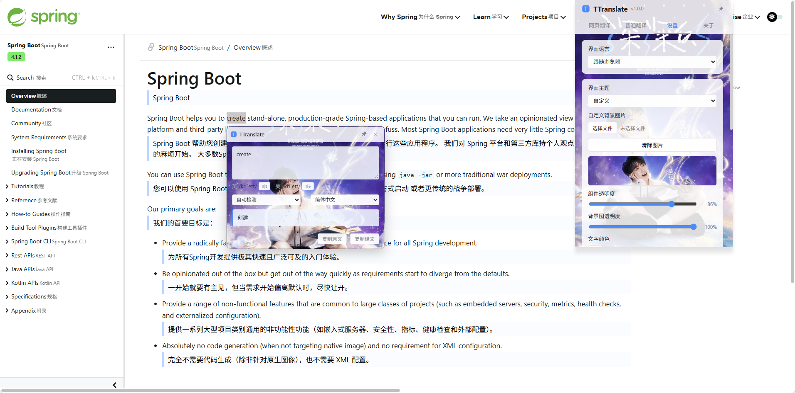

# TTranslate

[English](README.en.md) | 简体中文

> 一款浏览器对照翻译扩展。

## 界面预览

**整页双语对照 + 划词翻译**

**普通翻译：输入框 / 文本段落即时翻译**

**界面主题：自定义背景图、组件与背景透明度**

## 核心功能

| 功能 | 覆盖程度 | 说明 |
|---|---|---|
| 对照翻译 | ✅ 完整 | target-wrapper + 块/行内 + 位置 before/after + 主题 CSS 变量 |
| 普通翻译 | ✅ | 聚焦 input/textarea 敲 `/` 翻译当前内容 |
| 划词翻译 | ✅ | 选中文本后点击图标翻译 |

## 安装（Chrome / Edge）

1. 打开扩展管理页：`chrome://extensions/`
2. 右上角打开「开发者模式」
3. 点击「加载已解压的扩展程序」，选择 `TTranslate` 目录
4. 固定 TTranslate 到工具栏，点击图标打开 popup
5. 或者直接拖拽crx文件到扩展管理页

## 快捷键

| 操作 | 快捷键 |
|---|---|
| 切换当前页面翻译 | `Alt+T`） |
| 输入框翻译 | 在聚焦的 input/textarea 里敲 `/` |

## 许可证
本项目使用 MIT 协议开源，仅供学习交流使用。

